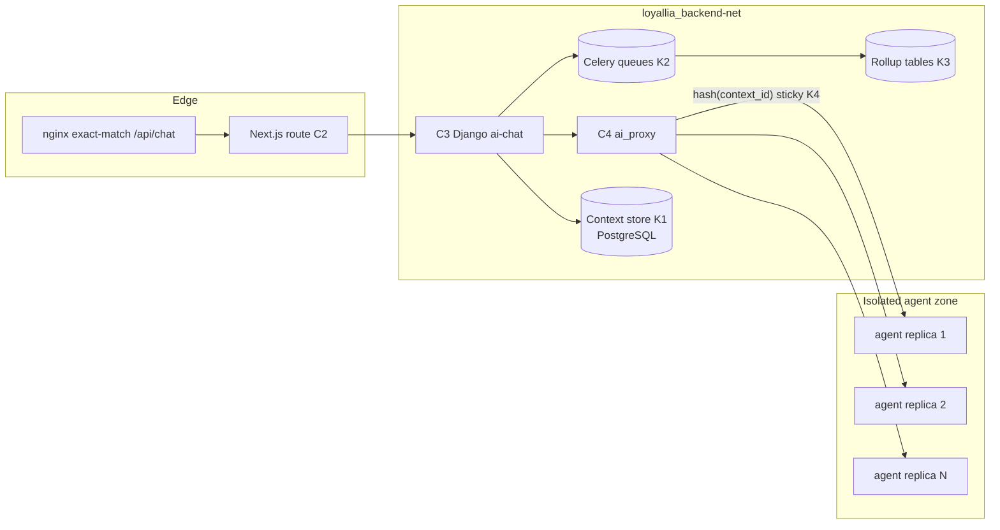
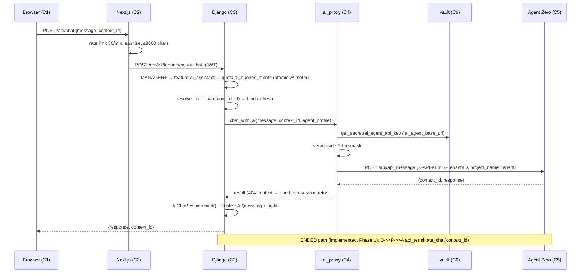

## DOCUMENT CONTROL

| Field | Details |
|-------|---------|
| **Document ID** | LOYALLIA-DOC-AGENT-V3-ARCH-001 |
| **Title** | LOYALLIA — Agent V3 Architecture: Agent Zero Integration, Conversation Lifecycle, Tenant Isolation & Scale |
| **Version** | 1.0 |
| **Date** | 2026-10-16 |
| **Author** | Engineering Lead |
| **Approver** | Product Owner |
| **Owner** | Engineering Lead |
| **Classification** | Internal Use |
| **Confidentiality** | Internal — Restricted to Engineering and Product teams |
| **Review Cycle** | Upon each major release, or annually (whichever comes first) |
| **Status** | draft |
| **Standard** | ISO/IEC 27001:2022, ISO 9001:2015, ISO/IEC 42010:2011 |
| **Parent Document** | LOYALLIA-DOC-ARCHITECTURE.MD |
| **Supersedes** | N/A (successor-in-scope to LOYALLIA-DOC-AGENT_ARCHITECTURE for the Agent V3 program) |
| **Language** | English |
| **Format** | Markdown (.md) |
| **Location** | `docs/02-architecture/LOYALLIA-DOC-AGENT-V3-ARCH-001.md` |

### Revision History

| Version | Date | Author | Description of Changes |
|---------|------|--------|------------------------|
| 1.0 | 2026-10-16 | Engineering Lead | Initial release. Defines the Agent V3 system architecture: vendored Agent Zero integration (`services/agent-zero`, MIT, pinned SHA), Django `ai_proxy` → agent HTTP API contract (`api_message` / `api_terminate_chat` / `agent_profiles`), conversation lifecycle state machine (active → idle-expired → ended), context binding (`AIChatSession`), the `project = tenant` isolation model (per-tenant projects, per-tenant `lyl_` keys, quotas), the scale architecture for millions of transactions (context store, async ingress, rollup-backed analytics, sticky routing, horizontal replicas), trust boundaries, data flows, and the AI surface inventory. |

### Distribution List

| Recipient | Role | Purpose |
|-----------|------|---------|
| Engineering Lead | Author / Owner | Maintains document |
| Product Owner | Approver | Architecture and scope validation |
| Security Officer | Reviewer | Trust boundaries, tenant isolation and secret handling validation |
| QA Lead | Reviewer | Requirement traceability and test coverage validation (feeds LOYALLIA-DOC-AGENT-V3-TEST-001) |

### Related Documents

| Document ID | Title | Relationship |
|-------------|-------|-------------|
| LOYALLIA-DOC-ARCHITECTURE.MD | Loyallia Architecture, Sequence & Flowchart Diagrams | Parent |
| LOYALLIA-DOC-AGENT_ARCHITECTURE.MD | AI Agent Architecture, Plan Binding & Isolation Model | Predecessor (V1/V2 as-built state, defect register D-01…D-16) |
| LOYALLIA-DOC-SRS-007-AI-INTEGRATION | Wallet Studio AI Integration SRS (Groq API) | Reference (design-endpoint AI surface) |
| LOYALLIA-DOC-MAINT-PLAN-001 | Software Maintenance Plan | Reference (release gates, vendor-sync of the Agent Zero fork) |
| LOYALLIA-DOC-AGENT-V3-TEST-001 | Agent Test & Verification Plan | Verification |
| LOYALLIA-RULES-001 | Loyallia Agent Rules And Coding Standards | Reference |
| LOYALLIA-AGENTS-001 | Loyallia Agent Instructions | Reference |
| LOYALLIA-DOC-BE-AGENT-API-001 | Agent API (backend/apps/agent_api/README.md) | Subject |
| LOYALLIA-DOC-BE-AI-001 | AI App (backend/apps/ai/README.md) | Subject |

### Change Control Process

1. All changes to this document MUST be recorded in the Revision History table above.
2. Status transitions: `draft` → `review` → `approved` → `active` → `deprecated` → `archived`.
3. Changes after `approved` status require a new version number and re-approval.
4. Minor corrections (typos, formatting) increment the minor version (e.g., 1.0 → 1.1).
5. Major changes (new requirements, scope changes) increment the major version (e.g., 1.0 → 2.0).
6. Deprecated documents MUST be moved to `docs/09-archive/` with a deprecation notice.
7. All dates in this document use ISO 8601 format (`YYYY-MM-DD`).

## DOCUMENT APPROVAL

| Role | Name | Signature | Date | Decision |
|------|------|-----------|------|----------|
| Engineering Lead | — | — | 2026-10-16 | Submitted |
| Product Owner | — | — | — | Pending Review |
| Security Officer | — | — | — | Pending Review |
| QA Lead | — | — | — | Pending Review |

### Document Lifecycle

| State | Date | Actor | Notes |
|-------|------|-------|-------|
| Draft | 2026-10-16 | Engineering Lead | Initial Agent V3 architecture drafted from code, Agent Zero source and LOYALLIA-DOC-AGENT_ARCHITECTURE evidence |

### Next Review Date

| Trigger | Date | Notes |
|---------|------|-------|
| Annual review | 2026-12-31 | End of year review cycle |
| Major release | — | Triggered by major platform release or Agent V3 phase gate |

---

# LOYALLIA — Agent V3 Architecture: Agent Zero Integration, Conversation Lifecycle, Tenant Isolation & Scale

> **Documento generado por agentes de IA con supervisión del equipo SomaTech LLC — sujeto a revisión y aprobación.**

## Table of Contents

1. [Purpose & Scope](#1-purpose--scope)
2. [AI Surface Inventory](#2-ai-surface-inventory)
3. [Component Architecture & Trust Boundaries](#3-component-architecture--trust-boundaries)
4. [Agent Zero Integration Contract](#4-agent-zero-integration-contract)
5. [Conversation Lifecycle State Machine](#5-conversation-lifecycle-state-machine)
6. [Context Binding Model](#6-context-binding-model)
7. [Tenant Isolation Model — `project = tenant`](#7-tenant-isolation-model--project--tenant)
8. [Scale Architecture (Millions of Transactions)](#8-scale-architecture-millions-of-transactions)
9. [Data Flows](#9-data-flows)
10. [Configuration, Secrets & Vendor Pinning](#10-configuration-secrets--vendor-pinning)
11. [Failure Modes & Degradation](#11-failure-modes--degradation)
12. [Acceptance Criteria](#12-acceptance-criteria)
13. [References](#13-references)

## 1. Purpose & Scope

This document is the architecture baseline for the **Agent V3 program** — the Agent Zero integration layer of Loyallia. It defines:

- the vendored Agent Zero runtime and its integration contract with Django (`ai_proxy`);
- the **conversation lifecycle state machine** (active → idle-expired → ended) and its context binding;
- the **`project = tenant` isolation model** (per-tenant projects, per-tenant `lyl_` keys, per-tenant quotas);
- the **scale architecture** targeting millions of transactions per period;
- trust boundaries, data flows, and the complete **AI surface inventory**.

Out of scope: LLM prompt content and wallet-studio design prompts (see `LOYALLIA-DOC-SRS-007-AI-INTEGRATION`), infrastructure provisioning (see `LOYALLIA-DOC-DEPLOYMENT_GUIDE`), and plan/pricing decisions (see `LOYALLIA-DOC-AGENT_ARCHITECTURE` §4.1, defect D-14).

**Status convention used in this document.** Columns marked *Implemented* reflect code verified per `LOYALLIA-DOC-AGENT_ARCHITECTURE` §11 (2026-10-15). Columns marked *V3 target* are requirements of this program and MUST be verified per `LOYALLIA-DOC-AGENT-V3-TEST-001` before status `approved`.

## 2. AI Surface Inventory

Every AI-facing surface of the platform, its trust zone and its authorization gate. Any new surface MUST be registered here before implementation.

| ID | Surface | Entry point (code path) | Consumer | Auth gate | Trust zone | Status |
|----|---------|------------------------|----------|-----------|-----------|--------|
| S1 | Dashboard chatbot | `frontend/src/components/chat/Chatbot.tsx` → `frontend/src/app/api/chat/route.ts` → `/api/v1/tenants/me/ai-chat/` | Tenant users (MANAGER+) | JWT Bearer + `ai_assistant` feature + `ai_queries_month` quota | Untrusted (browser) → Edge → Trusted | Implemented |
| S2 | Design endpoints (Kimi/Groq) | `backend/apps/ai/urls.py`: `generate-template/`, `suggest-colors/`, `critique-design/`, `suggest-stamp-icons/`, `suggest-layout/` (`/api/v1/ai/…`) | Wallet Studio | JWT + tenant + plan quota (`AIQueryLog` per call) | Trusted (Django) → external Groq API | Implemented |
| S3 | Agent data plane | `backend/apps/agent_api/` — 5 read-only GETs (`/agent/context/`, `/agent/customers/summary/`, `/agent/programs/`, `/agent/analytics/overview/`, `/agent/transactions/recent/`) | External AI agents | `AgentAPIKeyAuth` (per-tenant API key, `agent_api` feature, `api_calls_day` quota) | Trusted, API-key gated | Implemented |
| S4 | Agent key management | `backend/apps/agent_api/` — `GET/POST /agent/keys/`, `DELETE /agent/keys/{id}/` | Tenant OWNER / SUPER_ADMIN | JWT + OWNER role | Trusted | Implemented |
| S5 | Agent control plane (Django → Agent Zero) | `backend/apps/tenants/services/ai_proxy.py` → agent HTTP API (`api_message`, `api_terminate_chat`, `agent_profiles`) | Platform only (never client-direct) | Vault `ai_agent_api_key` (`X-API-KEY`) | Isolated network | `api_message` + `api_terminate_chat` Implemented (Phase 1, 2026-10-16); `agent_profiles` **V3 target** |
| S6 | Agent Zero UI | Container `loyallia-agent`, loopback only `127.0.0.1:34200` | Operators | Host loopback binding + agent web auth | Isolated network | Implemented |

## 3. Component Architecture & Trust Boundaries

### 3.1 Components

| # | Component | Location | Trust zone | Responsibility |
|---|-----------|----------|-----------|----------------|
| C1 | Dashboard chatbot | `frontend/src/components/chat/Chatbot.tsx` | Untrusted (browser) | Builds screen context, advisory PII mask, renders answer. **Never trusted for identity.** |
| C2 | Next.js chat proxy | `frontend/src/app/api/chat/route.ts` | Edge | Per-IP rate limit (30/min), sanitisation, size cap (≤ 8000 chars), forwards `Authorization` |
| C3 | Django AI chat endpoint | `backend/apps/tenants/api.py` → `/api/v1/tenants/me/ai-chat/` | Trusted | AuthZ (MANAGER+), plan/quota enforcement, session binding, usage metering, audit |
| C4 | AI proxy service | `backend/apps/tenants/services/ai_proxy.py` | Trusted | Vault secret injection, agent transport, server-side PII re-mask, retry, error normalisation |
| C5 | Agent Zero runtime (vendored) | `services/agent-zero/` (MIT, pinned SHA — §10) → container `loyallia-agent`, internal **:80** | Isolated network | Profile execution, tools, knowledge, memory, conversation contexts |
| C6 | HashiCorp Vault | container `loyallia-vault`, KV v2 `secret/data/loyallia/production` | Secrets authority | `ai_agent_api_key`, `ai_agent_base_url`, `lyl_` per-tenant keys (§7) |
| C7 | Plan enforcement | `backend/common/plan_enforcement.py` | Trusted | Feature gates + quota limits |
| C8 | Agent data API | `backend/apps/agent_api/` | Trusted, API-key gated | Tenant-scoped read surface + key lifecycle |
| C9 | Async ingress / workers | Celery 5 (4 queues), `loyallia-celery` | Trusted | Non-blocking agent ingress, rollup jobs (§8) |
| C10 | Context store | PostgreSQL 17.4 (`loyallia_ai_chat_sessions`, `ai_query_log`) + Agent Zero `usr/chats/ctx-<context_id>/` | Trusted / isolated | Conversation state, binding, usage ledger |

### 3.2 Trust boundaries (ASCII)

```
┌── UNTRUSTED (browser) ──────────────────────────────────────────────┐
│  C1 Chatbot (Chatbot.tsx)                                          │
└───────────────┬────────────────────────────────────────────────────┘
                │ HTTPS + JWT (Authorization: Bearer)
┌── EDGE ───────▼─────────────────────────────────────────────────────┐
│  nginx (exact-match /api/chat) → C2 Next.js route (rate limit, cap) │
└───────────────┬────────────────────────────────────────────────────┘
                │ HTTPS + JWT forwarded
┌── TRUSTED (loyallia_backend-net) ───────────────────────────────────┐
│  C3 Django ai-chat ──► C7 plan_enforcement ──► C10 context store    │
│        │                                                            │
│        ▼                                                            │
│  C4 ai_proxy ── Vault (C6) key injection + PII re-mask              │
│        │  X-API-KEY + X-Tenant-ID + X-User-ID                       │
└────────┼───────────────────────────────────────────────────────────┘
         │ internal DNS http://ai-agent  (no public egress)
┌── ISOLATED (agent zone) ────────────────────────────────────────────┐
│  C5 Agent Zero (services/agent-zero, pinned)  :80                   │
│      project = tenant (§7) · profiles · knowledge/ · memory/        │
│      chats/ · tools · searxng · [V3: replicas + sticky routing]     │
└─────────────────────────────────────────────────────────────────────┘
```

Network boundary (as-built, `LOYALLIA-DOC-AGENT_ARCHITECTURE` §2): C3/C4/C9/C10 sit on `loyallia_backend-net`; C5 is attached with DNS alias `ai-agent` and has **no public ingress** except the loopback UI port `127.0.0.1:34200` (S6).

## 4. Agent Zero Integration Contract

Django talks to Agent Zero exclusively through `backend/apps/tenants/services/ai_proxy.py`. The contract below is derived from Agent Zero source (`api/api_message.py`, `helpers/api.py`) and MUST be re-verified on every vendor-sync (LOYALLIA-DOC-MAINT-PLAN-001 §6).

| Endpoint | Method | Purpose | Auth | Request (key fields) | Response | Status |
|----------|--------|---------|------|----------------------|----------|--------|
| `/api/api_message` | POST | Send a user message into a conversation context | `X-API-KEY` = Vault `ai_agent_api_key` (compared to `settings.mcp_server_token`; missing → `401 API key required`, wrong → `401 Invalid API key`) | `context_id?`, `message`, `attachments[]`, `lifetime_hours` (> 0, default 24), `project_name`, `agent_profile` | `{context_id, response}` | Implemented |
| `/api/api_terminate_chat` | POST | Explicitly end a conversation context (state `ENDED`, §5) | `X-API-KEY` | `context_id` | acknowledgement; unknown context → 404 | **Implemented (Phase 1, 2026-10-16)** (W3, §5) |
| `/api/agent_profiles` | GET | List available agent profiles for server-side selection and audit | `X-API-KEY` | — | profile catalogue (`loyallia-help`, `loyallia-campaigns`, …) | **V3 target** (W3, §7.3) |

Contract rules (binding):

| ID | Rule |
|----|------|
| R-API-01 | The API key never reaches the frontend; C4 injects it from Vault. Only `key_prefix` may be logged (`agent_api/auth.py` pattern). |
| R-API-02 | `lifetime_hours` MUST be > 0; Loyallia clamps it to `1 … 168` via `ai_agent_context_lifetime_hours` (default 24). |
| R-API-03 | A context keeps the `agent_profile` it was created with; profile changes on an existing context are rejected by the agent and MUST NOT be attempted (see R-LC-04). |
| R-API-04 | On `404 unknown context`, C4 retries **once** without `context_id` (transparent fresh session) instead of failing the user. |
| R-API-05 | Transport failures normalise to HTTP 503 `AI_ASSISTANT_UNAVAILABLE`; the platform never fabricates an answer. |
| R-API-06 | Upstream bodies are logged truncated (≤ 200 chars); prompt fragments never land whole in the log pipeline. |

## 5. Conversation Lifecycle State Machine

### 5.1 States

| State | Meaning | Persistence | Entry condition |
|-------|---------|-------------|-----------------|
| **ACTIVE** | Conversation bound and resumable | `AIChatSession` row (`is_active=True`, `expires_at > now`) + agent-side `usr/chats/ctx-<context_id>/` | First successful `api_message` response issued a `context_id` and C3 bound it (`AIChatSession.bind()`) |
| **IDLE-EXPIRED** | Idle beyond `lifetime_hours`; context no longer resumable | Row remains for audit (`expires_at <= now`); agent-side context purged by agent lifetime | `expires_at` passes without a message (idle expiry) |
| **ENDED** | Explicitly terminated before expiry | `is_active=False` (V3: `ended_at`, `end_reason`) + agent-side `api_terminate_chat` | Operator/user/system calls terminate; tenant deactivation; security kill |

### 5.2 Transitions

```
                 (bind on first message)
        ┌────────────────────────────────────┐
        │                                    ▼
   [ unbound ]                          [ ACTIVE ] ──── api_terminate_chat / deactivate ───▶ [ ENDED ]
                                          │   ▲                                            ▲
                       idle ≥ lifetime_hours   └── message while ACTIVE (expiry refresh)    │
                                          ▼                                                │
                                  [ IDLE-EXPIRED ] ── new message: fresh context ──────────┘ (old context never revived)
```

| ID | From | To | Trigger | Guard | Enforcement point |
|----|------|----|---------|-------|-------------------|
| R-LC-01 | unbound | ACTIVE | First `api_message` reply carries `context_id` | Reply `context_id` not already bound to a foreign tenant | `AIChatSession.bind()` — `backend/apps/ai/models.py` |
| R-LC-02 | ACTIVE | ACTIVE | Message while `expires_at > now` | `resolve_for_tenant()` passes (tenant + active + unexpired) | `AIChatSession.resolve_for_tenant()`; `expires_at` refreshed on each message |
| R-LC-03 | ACTIVE | IDLE-EXPIRED | `expires_at <= now` (idle ≥ `lifetime_hours`) | Automatic (time) | `resolve_for_tenant()` filters `expires_at__gt=now` → expired context transparently starts a new session |
| R-LC-04 | ACTIVE | ENDED | `api_terminate_chat` (V3), tenant deactivation, admin kill switch | Caller authorised (tenant owner of the context) | C3 terminate endpoint (V3) → C4 → agent; row sets `is_active=False` |
| R-LC-05 | IDLE-EXPIRED | — (terminal) | — | — | Old `context_id` is **never revived**; a new message creates a new context |
| R-LC-06 | ENDED | — (terminal) | — | — | `is_active=False` sessions are never resumed (`resolve_for_tenant()` filter) |
| R-LC-07 | any | fresh session | Client presents a `context_id` failing tenant/active/expiry checks | — | `resolve_for_tenant()` returns `None` → **no existence disclosure** (identical UX to "no context") |

Invariant: **a `context_id` never crosses tenants and never outlives `expires_at` in a resumable state.** Both are enforced server-side (D-04 remediation, verified 2026-10-15).

## 6. Context Binding Model

`AIChatSession` (`backend/apps/ai/models.py`, table `loyallia_ai_chat_sessions`, migration `ai.0004`) is the **single source of truth** for conversation binding.

| Field | Type | Binding semantics |
|-------|------|-------------------|
| `tenant` | FK → `tenants.Tenant` | Owner. Every resolution filters on it. |
| `context_id` | `CharField(128)`, **unique** | Agent-issued identifier; server-issued only — never minted by a client. |
| `agent_profile` | `CharField(64)` | Profile fixed at creation; re-sent every message (R-API-03). |
| `created_by_id` | UUID, nullable | Auditing only; not an authorization input. |
| `message_count` / `last_message_at` | counter / timestamp | Activity tracking; drives idle analysis and rollups (§8). |
| `is_active` | bool | `False` = ENDED; sessions with `is_active=False` are never resumed. |
| `expires_at` | datetime, indexed | Mirrors agent-side `lifetime_hours`; drives IDLE-EXPIRED. |

Binding rules:

| ID | Requirement | Enforcement |
|----|-------------|-------------|
| R-BD-01 | Every agent call carries the bound `context_id` **and** `X-Tenant-ID` / `X-User-ID` (opaque IDs only) | `ai_proxy.chat_with_ai()` |
| R-BD-02 | Client-supplied `context_id` MUST resolve via `resolve_for_tenant()` before forwarding; foreign/expired/inactive → `None` → fresh session | `AIChatSession.resolve_for_tenant()` |
| R-BD-03 | Concurrent first-bind of the same `context_id` adopts the winner row; adoption by a **different** tenant is refused and logged as a security anomaly | `AIChatSession.bind()` `IntegrityError` path |
| R-BD-04 | Chat content never enters the usage log — metadata only (`message_chars`, `agent_profile`) | `CostTracker.record_cost(request_data=…)` |
| R-BD-05 | Profile selection is server-derived (bound session or `PlatformSetting` `ai_agent_profile`); the request body can never choose a profile | `tenants/api.py:ai_chat_proxy` |

## 7. Tenant Isolation Model — `project = tenant`

Agent Zero's native isolation primitive is the **project**. Agent V3 binds it one-to-one to the tenant: **`project = tenant`**. Nothing agent-side is shared across tenants.

### 7.1 Isolation layers

| Layer | Mechanism | Keying | Current (V2) | V3 target |
|-------|-----------|--------|--------------|-----------|
| Conversation | `AIChatSession` tenant binding | `context_id` unique + tenant FK | Implemented | — |
| Project | Agent Zero `project_name` set to the tenant slug on every `api_message` | `project_name = tenant.slug` | Forwarded field exists; enforcement | Enforced server-side; agent rejects cross-project context access |
| Files & memory | Per-tenant `knowledge/`, `memory/`, `chats/` directories | `usr/<tenant-slug>/…` | Per-tenant directories (R-ISO-05) | Physical per-tenant root + deny-by-default path traversal guard |
| Secrets | Per-tenant `lyl_` keys in Vault KV v2 | `lyl_<tenant-slug>_<purpose>` (e.g. `lyl_acme_groq_key`) | Platform-level `ai_agent_api_key` | Per-tenant keys allowlisted; `put_secret` SUPER_ADMIN-only, audited (`common.vault.put_secret`) |
| Data plane | `agent_api` read surface | `require_tenant()` on all routes | Implemented (5 GETs) | Rollup-backed analytics (§8) |
| Quotas | Plan limits | `ai_queries_month`, `api_calls_day` per tenant | Implemented (`check_plan_limit`) | Per-project agent-side quotas mirrored from plan |

### 7.2 Isolation invariants

| ID | Invariant | Verification (see LOYALLIA-DOC-AGENT-V3-TEST-001 T4) |
|----|-----------|------|
| R-TI-01 | Two tenants presenting the same `context_id` each resolve only their own binding | `resolve_for_tenant()` tenant filter; E2E T4 |
| R-TI-02 | A `project_name` for tenant A can never read tenant B's knowledge/memory/chats | Per-tenant project roots; integration tests |
| R-TI-03 | `lyl_` keys are only readable by their owning tenant's runtime path | Vault policy + allowlist; security review |
| R-TI-04 | Quota exhaustion of tenant A never throttles tenant B | Per-tenant counters; load test §8 |
| R-TI-05 | Agent-side logs/traces contain tenant opaque IDs, never tenant names or PII | Log review; PII re-mask in C4 |

### 7.3 Profile → plan gating

Profiles are selected server-side (R-BD-05) from the plan matrix of `LOYALLIA-DOC-AGENT_ARCHITECTURE` §4 (Trial → `loyallia-help`; Enterprise → full catalogue; Starter/Professional → denied until D-14 is decided). V3 adds `GET /api/agent_profiles` so C3 can validate the configured `ai_agent_profile` against the catalogue at startup and fail closed on unknown profiles (role→profile gating is E2E case T5).

## 8. Scale Architecture (Millions of Transactions)

Target: sustained **millions of transactions per billing period** across all tenants, with analytics reads that do not degrade with raw transaction volume.

### 8.1 Scale mechanisms

| # | Mechanism | Description | Current (V2) | V3 target |
|---|-----------|-------------|--------------|-----------|
| K1 | **Context store** | Conversation state in PostgreSQL (`loyallia_ai_chat_sessions`) as system of record; agent-side `ctx-<id>` artefacts treated as ephemeral cache with TTL = `lifetime_hours` | Implemented (DB binding) | Context store partitioned by `tenant_id`; purge job for IDLE-EXPIRED artefacts |
| K2 | **Async ingress** | Agent traffic accepted synchronously for latency, but metering, audit fan-out, rollups and termination sweeps run through Celery queues (`loyallia-celery`) so request threads never block on analytics | Partial (audit + cost tracking inline) | Metering/rollup offloaded to Celery; bounded ingest queue with backpressure (429 at edge) |
| K3 | **Rollup-backed analytics** | `agent_api` analytics endpoints read pre-aggregated rollup tables (hourly/daily per tenant) instead of scanning raw `transactions` | Raw queries over recent data | Rollup tables + refresh cadence (≤ 15 min staleness); raw only for "recent 50" drill-down |
| K4 | **Sticky routing** | Requests for an existing `context_id` route to the replica holding its warm context: `hash(context_id) % replicas` at the edge/proxy; bind-time affinity for new contexts | Single container | Consistent-hash sticky routing across agent replicas; documented cache-miss fallback (context reload from K1) |
| K5 | **Horizontal replicas** | N `loyallia-agent` replicas behind the internal DNS name; stateless C3/C4 replicas already scale horizontally | 1 agent container | ≥ 2 replicas; health-gated rollout; per-replica context warm-up budget |

### 8.2 Capacity & service targets (to be ratified at Phase 1 gate)

| Metric | Target | Measurement |
|--------|--------|-------------|
| Chat message latency (P50 / P95) | ≤ 2.5 s / ≤ 8 s | k6 + server timings |
| Ingest throughput | ≥ 50 msg/s sustained platform-wide | k6 ramp-arrival-rate |
| Analytics endpoint (rollup-backed) P95 | ≤ 500 ms at 10⁶ transactions/tenant | k6 + seeded data |
| Context isolation violations | **0** | T4 suite + audit log |
| Quota accuracy | 100% of calls metered exactly once (no TOCTOU double-charge) | integration + load |
| Availability of chat path (degraded agent excluded) | 99.5% monthly | Prometheus/Loki + Alertmanager |

### 8.3 Scaling data flow (mermaid)



## 9. Data Flows

### 9.1 Chat message (as-built + V3 annotations)



### 9.2 Data classification along the flow

| Data | Where it flows | Control |
|------|----------------|---------|
| User message content | C1 → C2 → C3 → C4 → C5 | Advisory mask C1; authoritative re-mask C4; never in usage logs (R-BD-04) |
| `context_id` | C3 ↔ C5 | Server-issued, tenant-bound, unique |
| Tenant/user identity | C3 → C5 headers | Opaque IDs only (no names, no PII) |
| `ai_agent_api_key` | C6 → C4 memory | Never logged, never returned, derived at agent side |
| Usage/cost records | C3 → `ai_query_log` | Metadata only; per-tenant indexes |

## 10. Configuration, Secrets & Vendor Pinning

### 10.1 Configuration precedence (unchanged from V2)

1. **Vault secrets** (`ai_agent_api_key`, `ai_agent_base_url`, `lyl_*`) — secret material never in `.env`, code, or Git.
2. **`PlatformSetting`** runtime overrides — SUPER_ADMIN only, audited, allowlisted.
3. **Django settings** (`AI_AGENT_BASE_URL` fallback) — safe defaults only.
4. **Compiled defaults** in code.

### 10.2 Vendored Agent Zero

| Item | Value |
|------|-------|
| Upstream | `agent0ai/agent-zero` |
| License | MIT (license text MUST be preserved at `services/agent-zero/LICENSE`) |
| Vendor location | `services/agent-zero/` |
| Pinned upstream commit | `ff2a5b9c9c4e490ba38dd7c313e779510bb2071a` (MUST be a real 40-char SHA before the Phase 1 gate; recorded in `services/agent-zero/VENDOR.md`) |
| Loyallia fork delta | Loyallia patches recorded as a patch series in `VENDOR.md` (`lyl_` project isolation, profile catalogue, contract endpoints) |
| Sync procedure | LOYALLIA-DOC-MAINT-PLAN-001 §6 (vendor-sync); contract re-verification required after every sync (§4) |
| Derived API key | `mcp_server_token` = `urlsafe_b64(sha256(runtime_id:auth_login:auth_password))[:16]`, never persisted; synced agent → Vault by `deploy/scripts/sync_agent_config.sh` |

## 11. Failure Modes & Degradation

| Failure | Detection | User-visible behaviour | Mitigation |
|---------|-----------|------------------------|------------|
| Agent unreachable / timeout | `httpx` transport error or `HTTP_TIMEOUT_AI_PROXY` | 503 `AI_ASSISTANT_UNAVAILABLE` (verified live 2026-10-15) | Normalised error; never fabricate an answer; retry budget is 1 fresh-session retry only |
| Vault sealed / key missing | `AIProxyConfigError` | 503 `AI_ASSISTANT_NOT_CONFIGURED` | Healthcheck + Alertmanager (D-13 partial); non-destructive `vault-init` seeding (D-16) |
| Quota exhausted | `check_plan_limit` | 403 `PLAN_LIMIT_EXCEEDED` | Atomic meter (no TOCTOU); `discard_cost` on failed upstream calls |
| Context dropped by agent (404) | Agent response | Transparent fresh session (R-API-04) | One retry without `context_id` |
| Cross-tenant context attempt | `resolve_for_tenant()` / `bind()` refusal | Fresh session; no existence disclosure (R-LC-07) | Security anomaly logged (R-BD-03) |
| Replica cache miss (V3) | Sticky route lands on cold replica | Latency blip only | Reload context from K1 store; warm-up budget per replica |
| Ingest queue backlog (V3) | Celery queue depth alert | Edge 429 under sustained overload | Backpressure at C2; scale K5 replicas |

## 12. Acceptance Criteria

| # | Criterion | Verification |
|---|-----------|--------------|
| 1 | Two tenants presenting the same `context_id` each resolve only their own binding; no cross-tenant content is ever returned | E2E T4 + integration |
| 2 | Lifecycle: an expired context never resumes; a terminated context never resumes; both behave identically to "no context" from the client's view | E2E T1/T2 |
| 3 | `POST /api/api_message` — correct key → 200; no key → 401; wrong key → 401 | Integration |
| 4 | Quota enforced atomically; failed upstream calls are not charged | Integration + load |
| 5 | `project = tenant`: per-tenant projects, `lyl_` keys and quotas verified with zero violations | E2E T4 + security review |
| 6 | Role→profile gating: the profile a session runs under is derived server-side and matches the plan matrix | E2E T5 |
| 7 | Scale targets of §8.2 met in the load environment at 10⁶ seeded transactions | k6 (LOYALLIA-DOC-AGENT-V3-TEST-001 §6) |
| 8 | Pinned Agent Zero SHA recorded in `VENDOR.md` with preserved MIT license | Review (LOYALLIA-DOC-MAINT-PLAN-001 §6) |

## 13. References

**Documents**

| ID | Relevance |
|----|-----------|
| LOYALLIA-DOC-AGENT_ARCHITECTURE.MD | As-built V1/V2 agent architecture, plan binding matrix, defect register D-01…D-16, live evidence 2026-10-15 |
| LOYALLIA-DOC-ARCHITECTURE.MD | Platform architecture parent document |
| LOYALLIA-DOC-SRS-007-AI-INTEGRATION | Groq/Kimi design-endpoint surface (S2) |
| LOYALLIA-DOC-MAINT-PLAN-001 | Maintenance plan: vendor-sync, release gates, defect workflow |
| LOYALLIA-DOC-AGENT-V3-TEST-001 | Test & verification plan for this architecture |
| LOYALLIA-DOC-BE-AGENT-API-001 | Agent data plane (S3/S4) |
| LOYALLIA-DOC-BE-AI-001 | AI app (S2), `AIQueryLog`, `AIChatSession` |
| LOYALLIA-DOC-04-ACCESS-CONTROL-POLICY | Access control policy (ISO 27001 control set) |
| LOYALLIA-AGENTS-001 / LOYALLIA-RULES-001 | Mandatory engineering rules referenced throughout |

**Code**

| Path | Relevance |
|------|-----------|
| `services/agent-zero/` | Vendored Agent Zero runtime (MIT, pinned SHA, `VENDOR.md`) |
| `backend/apps/tenants/services/ai_proxy.py` | Agent transport, Vault injection, PII re-mask, retry |
| `backend/apps/tenants/api.py` (`/me/ai-chat/`) | Chat pipeline: gates, quota, binding, metering, audit |
| `backend/apps/ai/models.py` | `AIQueryLog`, `AIChatSession` (`resolve_for_tenant`, `bind`) |
| `backend/apps/ai/` (`services/kimi_service.py`, `urls.py`) | Design endpoints (S2) |
| `backend/apps/agent_api/` | Agent data plane + key management (S3/S4) |
| `backend/common/plan_enforcement.py`, `backend/common/vault.py` | Quotas, feature gates, secret access |
| `frontend/src/components/chat/Chatbot.tsx`, `frontend/src/app/api/chat/route.ts` | S1 chatbot + edge proxy |
| `deploy/scripts/sync_agent_config.sh`, `deploy/vault/init.sh` | Derived-key sync, non-destructive Vault seeding |
